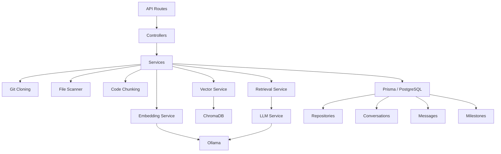

# RepoMind AI Backend

The backend is an Express.js application that handles repository cloning, indexing, retrieval, chat, conversations, milestones and API discovery.

## Backend overview

The backend exposes REST APIs under `http://localhost:5000/api`. It uses PostgreSQL for application metadata, ChromaDB for vector storage and Ollama for LLM inference and embeddings.

## Technology stack

- Node.js
- Express.js
- Prisma ORM
- PostgreSQL
- ChromaDB
- Ollama
- simple-git
- Axios
- jsdom
- Mermaid.js

## Backend architecture



## Folder structure

```text
backend/src/
  config/            Database, Ollama and Chroma configuration
  controllers/       HTTP request handlers
  routes/            Express route definitions
  services/          Business logic and RAG pipeline
  middleware/        Error handling
  utils/             Git and file utilities
  app.js             Express application setup
  server.js          Server entry point
```

## API documentation

Base URL: `http://localhost:5000/api`

### Repository APIs

#### Add repository

```http
POST /repositories
```

Request:

```json
{
  "url": "https://github.com/username/repository"
}
```

Response:

```json
{
  "id": "repository-id",
  "name": "repository",
  "owner": "username",
  "githubUrl": "https://github.com/username/repository",
  "status": "cloning"
}
```

#### List repositories

```http
GET /repositories
```

Response: array of repository objects.

#### Get repository details

```http
GET /repositories/:id
```

Response: repository metadata including languages and tech stack.

#### Get repository status

```http
GET /repositories/:id/status
```

Response:

```json
{
  "id": "repository-id",
  "status": "completed",
  "currentStage": "completed",
  "totalFiles": 10,
  "indexedFiles": 10,
  "totalChunks": 20
}
```

#### List repository files

```http
GET /repositories/:id/files
```

Response:

```json
{
  "files": [{ "path": "src/index.js", "language": "javascript" }],
  "tree": []
}
```

#### Read file content

```http
GET /repositories/:id/files/content?path=src/index.js
```

Response:

```json
{
  "path": "src/index.js",
  "content": "...",
  "lineCount": 42
}
```

#### Discover API endpoints

```http
GET /repositories/:id/apis
```

Response:

```json
{
  "apis": [
    {
      "method": "GET",
      "path": "/health",
      "file": "app/api/routes.py",
      "line": 28,
      "framework": "FastAPI"
    }
  ],
  "total": 1
}
```

#### Re-index repository

```http
POST /repositories/:id/reindex
```

Response:

```json
{
  "message": "Re-indexing started",
  "id": "repository-id"
}
```

#### Delete repository

```http
DELETE /repositories/:id
```

Response:

```json
{
  "success": true,
  "message": "Repository and associated data deleted successfully"
}
```

### Conversation APIs

#### Send chat message

```http
POST /chat
```

Request:

```json
{
  "repositoryId": "repository-id",
  "question": "Explain the authentication flow",
  "conversationId": "optional-conversation-id"
}
```

Response:

```json
{
  "answer": "Authentication is handled through...",
  "diagram": {
    "type": "mermaid",
    "code": "flowchart TD\nA[Client] --> B[Server]"
  },
  "sources": [
    {
      "filePath": "src/middleware/auth.middleware.js",
      "startLine": 10,
      "endLine": 32
    }
  ],
  "conversationId": "conversation-id"
}
```

#### List conversations

```http
GET /repositories/:id/conversations
```

Response: array of conversation objects.

#### Get conversation messages

```http
GET /conversations/:id/messages
```

Response: array of message objects.

#### Rename conversation

```http
PUT /conversations/:id
```

Request:

```json
{
  "title": "New title"
}
```

#### Delete conversation

```http
DELETE /conversations/:id
```

### Milestone APIs

#### List milestones

```http
GET /repositories/:id/milestones
```

#### Create milestone

```http
POST /repositories/:id/milestones
```

Request:

```json
{
  "title": "Architecture Overview",
  "summary": "Summary text"
}
```

#### Update milestone

```http
PUT /milestones/:milestoneId
```

#### Delete milestone

```http
DELETE /milestones/:milestoneId
```

### Health check

```http
GET /health
```

Response:

```json
{
  "status": "ok"
}
```

## Example cURL commands

Create a repository:

```bash
curl -X POST http://localhost:5000/api/repositories \
  -H "Content-Type: application/json" \
  -d '{"url":"https://github.com/left-pad/left-pad"}'
```

Send a chat message:

```bash
curl -X POST http://localhost:5000/api/chat \
  -H "Content-Type: application/json" \
  -d '{"repositoryId":"repository-id","question":"Explain the project architecture."}'
```

## Repository indexing workflow

1. User submits a GitHub URL.
2. Backend validates the URL.
3. Repository is cloned locally.
4. Unnecessary files and directories are excluded.
5. Supported source files are identified.
6. Source code is read and processed.
7. Code is divided into chunks.
8. Embeddings are generated using Ollama.
9. Vectors and metadata are stored in ChromaDB.
10. Repository metadata is saved in PostgreSQL.

## Conversational RAG workflow

1. User selects a repository and conversation.
2. User sends a question.
3. Backend loads conversation history, summary and milestones.
4. Relevant code chunks are retrieved.
5. Context is assembled and sent to Ollama.
6. Ollama generates an answer.
7. Backend returns the answer, sources and optional diagram.
8. Conversation history is saved.

## Conversation memory and milestones

- Conversations belong to a single repository.
- Messages are stored in PostgreSQL.
- Conversation summaries are generated periodically.
- Milestones store reusable knowledge summaries.
- Relevant milestones are included as context for future questions.

## Ollama integration

- Backend connects to Ollama at `OLLAMA_BASE_URL`.
- Default LLM model: `qwen2.5:3b`.
- Default embedding model: `nomic-embed-text`.
- Prompts include retrieved code context and grounding rules.
- Responses are processed and returned with source references.

## How to start the backend

```bash
cd backend
cp .env.example .env
npm install
docker compose up -d
npx prisma migrate dev
npm run dev
```

The backend runs on `http://localhost:5000`.

## Error handling and limitations

Current limitations:

- Only public GitHub repositories are supported.
- Repository size and file limits are configurable.
- Mermaid diagrams depend on LLM output quality.
- API discovery uses pattern matching and may not cover every framework.
- No authentication or multi-user support.

Error handling covers invalid URLs, clone failures, missing files, Ollama errors, database errors and invalid Mermaid syntax. Errors are returned as JSON messages without stack traces.