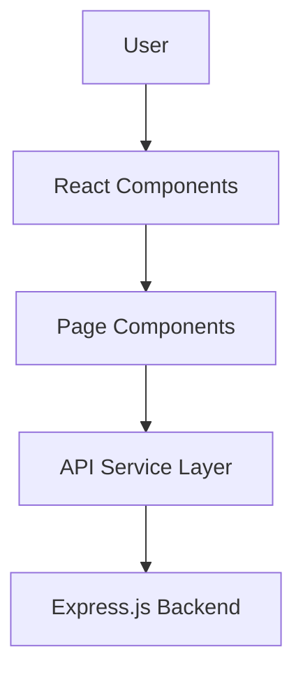

# RepoMind AI Frontend

The frontend is a React application built with Vite and Ant Design. It provides the dashboard, repository management, file explorer, chat interface, API explorer and milestone management.

## Overview

The frontend communicates with the Express.js backend at `http://localhost:5000/api`.

Main responsibilities:

- Display repository statistics and recent repositories.
- Accept GitHub repository URLs for analysis.
- Show repository indexing status.
- Provide a repository workspace with file explorer, chat, source references, API explorer and milestones.
- Render Markdown responses and Mermaid architecture diagrams.

## Technology stack

- React 19
- Vite
- Ant Design 6
- React Router 7
- Axios
- Mermaid.js
- react-markdown
- remark-gfm
- rehype-highlight
- highlight.js

## Folder structure

```text
frontend/src/
  components/        Reusable React components
  pages/             Application pages
  layouts/           Main dashboard layout
  services/          Axios API service
  utils/             Validators and file tree helpers
  styles/            Global CSS
```

Important components:

- `components/MarkdownMessage.jsx` renders assistant responses as Markdown.
- `components/CodeBlock.jsx` renders highlighted code with a copy button.
- `components/ArchitectureDiagram.jsx` renders Mermaid diagrams.
- `components/MarkdownMessage.jsx` also renders Mermaid blocks as diagrams.

## Pages and features

- **Dashboard**: repository counts, indexed files, detected languages and recent repositories.
- **Repositories**: submit a repository URL, view repository list, open or delete repositories.
- **Repository Workspace**: file explorer, chat, source references, API explorer, milestones, re-index and delete.
- **Indexing History**: repository indexing status and details.
- **Settings**: basic configuration display.

## Frontend architecture



Chat messages are stored per conversation. Switching repositories or conversations loads the correct message history from the backend.

Source references are clickable and open the corresponding file in the file explorer.

## API integration

The frontend uses `src/services/api.js`.

Main API calls:

- `POST /repositories` - create and analyze a repository.
- `GET /repositories` - list repositories.
- `GET /repositories/:id` - get repository details.
- `GET /repositories/:id/status` - get indexing status.
- `GET /repositories/:id/files` - list repository files.
- `GET /repositories/:id/files/content?path=...` - read file content.
- `GET /repositories/:id/conversations` - list conversations.
- `POST /chat` - send a chat message.
- `GET /conversations/:id/messages` - get conversation messages.
- `PUT /conversations/:id` - rename a conversation.
- `DELETE /conversations/:id` - delete a conversation.
- `GET /repositories/:id/apis` - discover API endpoints.
- `GET /repositories/:id/milestones` - list milestones.
- `POST /repositories/:id/milestones` - create a milestone.
- `DELETE /milestones/:id` - delete a milestone.
- `POST /repositories/:id/reindex` - re-index a repository.
- `DELETE /repositories/:id` - delete a repository.

## How to start

```bash
cd frontend
npm install
npm run dev
```

The frontend runs on `http://localhost:5173` and communicates with the backend at `http://localhost:5000/api`.

## Build

```bash
cd frontend
npm run build
```

The production build is generated in the `dist` directory.